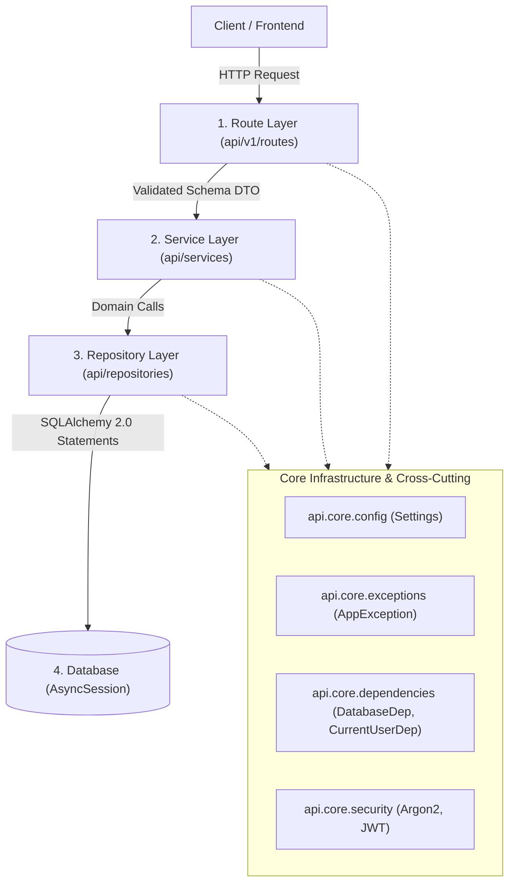

# HUCE-KMS — Backend AI Coding Agent Guidelines

> **Project**: HUCE-KMS (Knowledge Management System & AI Assistant - Hanoi University of Civil Engineering)  
> **Application**: `apps/backend`  
> **Python Version**: `>= 3.12`  
> **Core Frameworks**: FastAPI, SQLAlchemy 2.0 (Asyncio), Pydantic V2, Pydantic Settings, Pwdlib (Argon2id), PyJWT  
> **Package & Build Tool**: `uv` (`uv_build` backend)

---

## 1. Backend Overview

`apps/backend` provides all RESTful APIs, authentication services, role-based access control (RBAC), user management, and academic knowledge management for the HUCE-KMS platform.

The backend is built following an asynchronous (Async/Await throughout) **Layered Architecture** (Service-Oriented Clean Architecture).

> [!IMPORTANT]
> **Active Database & Technology Reality**:
> - In the current development environment, the database is **SQLite (`huce_kms.db`) via SQLAlchemy 2.0 Async Engine with `aiosqlite`**.
> - Upgrading to **PostgreSQL** and **Qdrant Vector Database** represents future planned architectural targets (scheduled for Document Ingestion & RAG Pipeline phases).
> - AI Agents **MUST NOT** import `asyncpg`, `psycopg`, or `qdrant_client` as these libraries are not installed in `pyproject.toml`.

---

## 2. Source Code Structure

Backend source code resides in `src/` with the package root named `api` (declared via `[tool.uv.build-backend] module-name = "api"` in `pyproject.toml`):

```text
apps/backend/
├── migrations/               # Alembic configuration & migration scripts
│   ├── env.py                # Async migration runner bound to target_metadata = Base.metadata
│   └── script.py.mako        # Migration template file
├── src/
│   └── api/
│       ├── core/             # Core infrastructure: config, db, deps, exceptions, lifespan, logging, security
│       ├── models/           # SQLAlchemy 2.0 ORM Models (inheriting Base & TimestampMixin)
│       ├── repositories/     # Data Access Layer (BaseRepository and entity repositories)
│       ├── schemas/          # Pydantic V2 DTOs (BaseResponse, PaginatedData, Request/Response schemas)
│       ├── services/         # Business Logic Layer (AuthService, UserService, etc.)
│       ├── v1/
│       │   └── routes/       # API Route Controllers (auth, users, router.py)
│       └── main.py           # FastAPI Application Entry Point & Lifespan handler
├── alembic.ini               # Alembic configuration file
├── huce_kms.db               # Local development SQLite database file
├── pyproject.toml            # Project metadata, build configuration, and dependencies
└── uv.lock                   # Exact locked versions of installed packages
```

---

## 3. Layer Responsibilities



### 3.1. Route Layer (`api/v1/routes/`)
- Receives HTTP requests, parses query/path parameters and request bodies via Pydantic schemas.
- Manages HTTP status codes (`status.HTTP_200_OK`, `status.HTTP_201_CREATED`, etc.).
- Manages HTTP cookies (e.g., `set_refresh_token_cookie`, `clear_refresh_token_cookie`).
- Wraps all return data into the standardized `BaseResponse[T]` envelope.
- **Strict Prohibition**: **NEVER** execute raw database queries, call SQLAlchemy statements, or place complex business logic directly inside route handlers.

### 3.2. Service Layer (`api/services/`)
- Contains all **Business Logic** and domain rules of the application.
- Validates logical constraints (e.g., duplicate email/username, current password checks, account active status).
- Orchestrates interactions across multiple repositories.
- When domain errors occur, raises custom exceptions inheriting from `AppException` (`BadRequestException`, `ConflictException`, `EntityNotFoundException`, `UnauthorizedException`, `ForbiddenException`).
- **Strict Prohibition**: **NEVER** depend on FastAPI HTTP primitives such as `Request`, `Response`, `Cookie`, or `Header`.

### 3.3. Repository Layer (`api/repositories/`)
- Interacts directly with the database via `AsyncSession`.
- Inherits from `BaseRepository[ModelType]` to reuse standard CRUD operations: `get_by_id`, `list`, `create`, `update`, `delete`.
- Implements specialized queries using SQLAlchemy 2.0 syntax (`select`, `where`, `join`, `func.count`).
- **Critical Transaction Rule**: Repositories MUST only call `await self.session.flush()` and `await self.session.refresh()`. **NEVER** call `await self.session.commit()`, as commit and rollback cycles are managed centrally by the `DatabaseDep` (`get_db_session`) request lifecycle dependency.

### 3.4. Models Layer (`api/models/`)
- Defines database tables using SQLAlchemy 2.0 Declarative ORM.
- All models MUST inherit from `Base` (combining `AsyncAttrs` and `DeclarativeBase`) and `TimestampMixin` (providing timezone-aware `created_at` and `updated_at`).
- Uses modern type annotations: `Mapped[...]` and `mapped_column(...)`.

### 3.5. Schemas Layer (`api/schemas/`)
- Defines Data Transfer Objects (DTOs) using **Pydantic V2**.
- Clearly separates:
  - Base schema: `UserBase`
  - Create schema: `UserCreate`, `AdminUserCreate`
  - Update schema: `UserUpdate`, `UserStatusUpdate`, `UserRoleUpdate`
  - Response schema: `UserResponse` (MUST configure `model_config = ConfigDict(from_attributes=True)` to read ORM models).
- Provides global response envelope schemas: `BaseResponse[DataType]`, `PaginatedData[DataType]`, `PaginationMeta`.

### 3.6. Core Layer (`api/core/`)
- Houses cross-cutting infrastructure: environment configuration (`config.py`), database engine (`database.py`), dependency injection (`dependencies.py`), centralized exception handling (`exceptions.py`), application lifespan management (`lifespan.py`), rotating file logging (`logging.py`), security middleware (`middleware.py`), and Argon2/JWT security (`security.py`).

---

## 4. Mandatory Dependency Direction

AI Agents MUST strictly adhere to the one-way architectural dependency flow:

$$\text{Routes} \longrightarrow \text{Services} \longrightarrow \text{Repositories} \longrightarrow \text{Database / Models}$$

- **Allowed Flow**:
  - `routes` call `services`.
  - `services` call `repositories`.
  - `repositories` interact with `models` and `AsyncSession`.
  - All layers may reference `core` and `schemas`.
- **Anti-patterns (Strictly Forbidden)**:
  - ❌ `routes` calling `repositories` or `models` directly, bypassing `services`.
  - ❌ `services` importing or depending backwards on `routes`.
  - ❌ `repositories` depending on `services`.
  - ❌ `models` importing `services` or `routes`.

---

## 5. Backend Implementation Rules

1. **Async/Await Throughout**:
   - Every function in Routes, Services, Repositories, Middleware, Lifespan, and Database dependencies MUST be asynchronous (`async def`) and use `await` on all I/O operations.
2. **Centralized Transaction Management**:
   - The `DatabaseDep` dependency (`get_db_session` in `api/core/dependencies.py`) automatically opens the transaction, commits on successful completion, and rolls back on unhandled exceptions:
     ```python
     async with async_session_factory() as session:
         try:
             yield session
             await session.commit()
         except Exception:
             await session.rollback()
             raise
     ```
   - In services and repositories, do not commit transactions manually.
3. **Standardized Response Envelope**:
   - All functional endpoints MUST return a `BaseResponse[DataType]` object.
   - Domain errors MUST be raised via `AppException` (or subclass) so that `format_error_response` automatically formats the error payload:
     ```json
     {
       "success": false,
       "code": "ENTITY_NOT_FOUND",
       "message": "User with ID '999' not found.",
       "details": {"entity_name": "User", "entity_id": 999},
       "data": null
     }
     ```
4. **Dependency Injection via Factory Functions**:
   - In route modules, initialize services using factory dependency functions:
     ```python
     def get_user_service(db: DatabaseDep) -> UserService:
         user_repo = UserRepository(db)
         refresh_token_repo = RefreshTokenRepository(db)
         return UserService(user_repo, refresh_token_repo)

     UserServiceDep = Annotated[UserService, Depends(get_user_service)]
     ```
5. **Authentication and RBAC**:
   - Endpoints requiring authentication: Inject `CurrentUserDep`.
   - Admin-only endpoints: Inject `AdminUserDep`.
   - In development environments (`settings.DEBUG = True`), mock bypass tokens are supported: `"admin-token"` and `"user-token"`.

---

## 6. Extending New Modules (Step-by-Step Procedure)

When creating a new domain entity (e.g., Documents, Categories, Chat Conversations), execute the following 6 steps in sequence:

1. **Step 1 — Model**: Create `api/models/<entity>.py` inheriting `Base` and `TimestampMixin`, declare `Mapped[...]` columns, and export in `api/models/__init__.py`.
2. **Step 2 — Schemas**: Create `api/schemas/<entity>.py` defining `Base`, `Create`, `Update`, and `Response` DTOs, and export in `api/schemas/__init__.py`.
3. **Step 3 — Repository**: Create `api/repositories/<entity>.py` inheriting `BaseRepository[<Entity>]`, implement domain-specific queries, and export in `api/repositories/__init__.py`.
4. **Step 4 — Service**: Create `api/services/<entity>.py` receiving repositories via constructor, implement business rules, validation, and error handling, and export in `api/services/__init__.py`.
5. **Step 5 — Routes**: Create `api/v1/routes/<entities>.py`, define the `get_<entity>_service` factory dependency, and implement endpoints returning `BaseResponse`.
6. **Step 6 — Router Mount**: Register the new router in `api/v1/routes/router.py`.

---

## 7. Dependencies & Tooling Policy

The project uses a locked and verified package suite in `pyproject.toml` / `uv.lock`:
- Web framework: `fastapi[standard] >= 0.162.2`
- Database: `sqlalchemy[asyncio] >= 2.0`, `aiosqlite >= 0.20.0`, `alembic >= 1.13.0`
- Security & Auth: `pwdlib[argon2] >= 0.2.1`, `pyjwt >= 2.9.0`
- Settings: `pydantic-settings`

> [!NOTE]
> **Alembic Migrations**: Currently, the local SQLite database schema is initialized on startup in lifespan (`lifespan.py`). When official schema changes are required, generate migration scripts using `uv run alembic revision --autogenerate -m "<message>"`.

> [!WARNING]
> Do NOT install unapproved external dependencies (such as passlib, python-jose, tortoise-orm, pydantic v1, asyncpg, or qdrant-client) without explicit approval. When package changes are required, use `uv add <package>` from `apps/backend`.

---

## 8. Verification & Development Commands

1. **Syntax and Import Validation**:
   ```bash
   cd apps/backend
   uv run python -c "import api.main; print('Import OK')"
   ```
2. **Run Development Server**:
   ```bash
   cd apps/backend
   uv run fastapi dev src/api/main.py
   # or
   uv run uvicorn api.main:app --reload --port 8000
   ```
3. **API Documentation Endpoints**:
   - Swagger UI: `http://localhost:8000/docs`
   - ReDoc: `http://localhost:8000/redoc`
   - Health check: `http://localhost:8000/health`

---

## 9. Technical References

### 9.1. Audit & Governance Reports
- **System Audit Report**: [docs/project-analysis/project-audit.md](file:///docs/project-analysis/project-audit.md)
- **AI Guide Update Plan**: [docs/project-analysis/ai-guide-update-plan.md](file:///docs/project-analysis/ai-guide-update-plan.md)

### 9.2. Foundational Architecture & Standards
- **Backend Architecture**: [docs/architecture/backend-architecture.md](file:///docs/architecture/backend-architecture.md)
- **Coding Standards**: [docs/engineering/coding-standards.md](file:///docs/engineering/coding-standards.md)
- **Naming Conventions**: [docs/engineering/naming-conventions.md](file:///docs/engineering/naming-conventions.md)

### 9.3. Detailed Engineering Rulebooks
- **API Conventions (`API-xxx`)**: [docs/engineering/api-conventions.md](file:///docs/engineering/api-conventions.md)
- **Schema Validation Rules (`SCH-xxx`)**: [docs/engineering/schema-validation-rules.md](file:///docs/engineering/schema-validation-rules.md)
- **Database & ORM Rules (`DB-xxx`)**: [docs/engineering/database-orm-rules.md](file:///docs/engineering/database-orm-rules.md)
- **Repository & Service Rules (`REP-xxx`)**: [docs/engineering/repository-service-rules.md](file:///docs/engineering/repository-service-rules.md)
- **Exception & Logging Rules (`EXC-xxx`)**: [docs/engineering/exception-logging-rules.md](file:///docs/engineering/exception-logging-rules.md)
- **Security Rules (`SEC-xxx`)**: [docs/engineering/security-rules.md](file:///docs/engineering/security-rules.md)
- **Testing Rules (`TST-xxx`)**: [docs/engineering/testing-rules.md](file:///docs/engineering/testing-rules.md)
