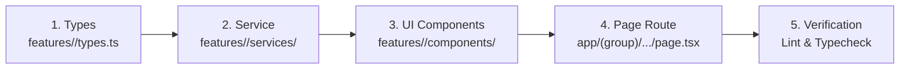

<!-- BEGIN:nextjs-agent-rules -->

## This is NOT the Next.js you know

This version has breaking changes — APIs, conventions, and file structure may all differ from your training data. Read the relevant guide in `node_modules/next/dist/docs/` (resolved from this file's directory; in monorepos the `next` package may not be visible from the repo root) before writing any code. Heed deprecation notices.

This block is written and re-added by `next dev` — verify at `node_modules/next/dist/server/lib/generate-agent-files.js`. Removing it from a diff only re-creates the uncommitted change; committing it with your work keeps the tree clean.

<!-- END:nextjs-agent-rules -->

# HUCE-KMS — Frontend AI Coding Agent Guidelines

> **Project**: HUCE-KMS (Knowledge Management System & AI Assistant - Hanoi University of Civil Engineering)  
> **Application**: `apps/web`  
> **Core Framework**: Next.js 16.4.3 (App Router, Turbopack), React 19.3.0, TypeScript 5.9.3  
> **UI & Styling**: Tailwind CSS v4, Base UI (`@base-ui/react`), shadcn (base-nova preset), Lucide React  
> **State & Forms**: Zustand 5.1, React Hook Form 7.91, Zod 4.6  
> **Package Manager**: `pnpm` (managed independently within `apps/web`)

---

## 1. Frontend Overview

`apps/web` is the client-side application providing the user interface for faculty, staff, students, and system administrators of HUCE-KMS.

Key system capabilities include:
1. Academic document and regulation search and inspection.
2. Real-time conversational AI assistant powered by Server-Sent Events (SSE) streaming.
3. System administration for automated crawlers, user accounts, and platform metrics.
4. Authentication session management via JWT Access Tokens and HTTP-only Cookie Refresh Tokens.

---

## 2. Directory & Module Architecture

The frontend follows a **Feature-Driven Architecture** integrated with the Next.js App Router:

```text
apps/web/src/
├── app/                              # Next.js 16 App Router (Layouts & Routes)
│   ├── (admin)/                      # Admin route group (with dedicated admin layout & sidebar)
│   │   └── admin/
│   │       ├── dashboard/            # Metrics dashboard
│   │       ├── users/                # User account management
│   │       ├── documents/            # Document management & chunk status
│   │       └── crawler/              # Crawler sources & schedule config
│   ├── (auth)/                       # Authentication route group (login, register)
│   ├── (user)/                       # End-user route group
│   │   ├── chat/                     # AI Chatbot interactive interface
│   │   └── profile/                  # User profile & settings
│   ├── globals.css                   # Tailwind CSS v4 theme & HUCE Blue Tokens
│   ├── layout.tsx                    # Root Layout (Inter font, Toaster sonner)
│   └── page.tsx                      # Landing page introducing HUCE KMS
│
├── components/                       # Shared reusable components
│   ├── layout/                       # Header and Sidebar components for User and Admin
│   ├── shared/                       # Business-agnostic shared widgets: data-table-pagination, confirm-dialog, empty-state
│   └── ui/                           # UI Primitives: button, input, dialog, select, table, breadcrumb, pagination, etc.
│
├── features/                         # Feature-driven modules (colocated by business domain)
│   ├── auth/                         # components, services, types for Authentication
│   ├── chat/                         # components, services, types for AI Chatbot & Streaming
│   ├── crawler/                      # services, types for data crawling
│   ├── dashboard/                    # services, types for statistics
│   ├── documents/                    # components, services, types for document management
│   └── users/                        # services, types for user administration
│
├── config/                           # Site configuration and metadata (site.ts)
├── constants/                        # Route constants and URLs (routes.ts)
├── hooks/                            # Custom React Hooks (use-debounce, use-media-query)
├── lib/                              # Core utilities & infrastructure:
│   ├── api-client.ts                 # Fetch wrapper with Bearer token injection & 401 auto-refresh
│   ├── sse.ts                        # Multi-byte UTF-8 Vietnamese SSE streaming parser
│   └── utils.ts                      # Class merger helper cn() (clsx + tailwind-merge)
├── stores/                           # Global Zustand Stores (use-sidebar-store.ts)
└── types/                            # Global DTOs & API response types (api.ts, user.ts)
```

---

## 3. React 19 & Next.js 16 Rules

### 3.1. Server vs. Client Component Separation
- **All components in `app/` are Server Components by default**. Only add the `"use client"` directive at the top of a file when the component:
  - Uses React hooks (`useState`, `useEffect`, `useCallback`, `useMemo`, `useRef`).
  - Attaches DOM event handlers (`onClick`, `onChange`, `onSubmit`).
  - Accesses browser APIs (`window`, `localStorage`, `document`).
- Keep Server Components as outer structural containers and push Client Components down to leaf nodes to maximize SSR and streaming benefits.

### 3.2. State Management & React 19 Hooks
- **STRICTLY PROHIBITED**: Calling `setState` inside `useEffect` during the render lifecycle (`react-hooks/set-state-in-effect`).
  - Do NOT use `useEffect` to synchronize props to internal state.
  - Reset state (such as resetting `currentPage` to `1` when filters or search queries change) **directly within the event handler** (e.g., `handleFilterChange`, `handleSearchInput`).

### 3.3. Dynamic Route Parameters in Next.js 16
- In Next.js 16, `params` and `searchParams` passed to Server Components are Promises:
  ```tsx
  // Standard Next.js 16 App Router Page
  interface PageProps {
    params: Promise<{ id: string }>;
  }

  export default async function ChatDetailPage({ params }: PageProps) {
    const { id } = await params;
    return <ChatContainer conversationId={id} />;
  }
  ```

---

## 4. UI & Styling Conventions (Tailwind CSS v4 & Base UI)

### 4.1. HUCE Theme Tokens
The interface complies with the official visual identity of Hanoi University of Civil Engineering in `src/app/globals.css`:
- Primary Colors: `--color-huce-navy` (`#002855`), `--color-huce-blue` (`#005A9C`).
- Accent Color: `--color-huce-accent` (`#EAA92A`).
- Background Surfaces: `--color-huce-bg` (`#F8FAFC`).
- Typography: `--color-huce-text` (`#1E293B`), `--color-huce-muted` (`#64748B`).

### 4.2. Class Name Merging via `cn()`
- Always use `cn()` from `@/lib/utils` to merge and override Tailwind utility classes:
  ```tsx
  import { cn } from "@/lib/utils";

  export function CustomCard({ className, ...props }: CardProps) {
    return <div className={cn("rounded-xl border bg-white p-6 shadow-sm", className)} {...props} />;
  }
  ```
- ⚠️ **shadcn CLI Import Caveat**: `pnpm dlx shadcn@latest add ...` may erroneously generate imports `from "cn"` instead of `from "@/lib/utils"`. When adding components, always verify and correct this import path.

### 4.3. Standard UI Primitives
- Already installed in `src/components/ui/`: `Button`, `Input`, `Label`, `Card`, `Dialog`, `DropdownMenu`, `Select`, `NativeSelect`, `Pagination`, `Breadcrumb`, `Table`, `Badge`, `Avatar`, `Sonner`, `Tooltip`.
- Do NOT rewrite primitive components if they already exist in `components/ui/`.

---

## 5. API Integration & Data Handling

### 5.1. Using `apiClient` (`src/lib/api-client.ts`)
- All REST requests to the Backend MUST use `apiClient`:
  ```tsx
  import { apiClient } from "@/lib/api-client";
  import type { UserResponse } from "@/types/user";

  export async function fetchUsers(): Promise<UserResponse[]> {
    return apiClient.get<UserResponse[]>("/users");
  }
  ```
- `apiClient` automatically:
  - Injects `Authorization: Bearer <access_token>`.
  - Unwraps the `BaseResponse[T]` envelope to return `data` directly.
  - Intercepts HTTP 401: invokes the refresh token endpoint and retries the original request once.

### 5.2. AI Chatbot Streaming via Server-Sent Events (`src/lib/sse.ts`)
- AI conversational answers stream over SSE via `parseSSEStream`.
- The parser correctly decodes multi-byte UTF-8 Vietnamese characters across chunk boundaries.

### 5.3. Mock Data vs. Live Backend APIs
- Modules `documents`, `crawler`, and `dashboard` currently supply mock data in `features/<feature>/services/` for independent UI testing.
- When connecting live backend endpoints, preserve the existing interfaces in `features/<feature>/types.ts` to avoid breaking downstream UI components.

---

## 6. Feature Development Workflow

When implementing a new screen or functional component, execute the following 5 steps:



1. **Step 1 — Define Types**: Declare TypeScript interfaces for DTOs, payloads, and filter parameters in `features/<name>/types.ts`.
2. **Step 2 — Build Service**: Create the service layer in `features/<name>/services/<name>-service.ts` using `apiClient`.
3. **Step 3 — Build Sub-components**: Construct atomic UI components in `features/<name>/components/`.
4. **Step 4 — Assemble Page Route**: Create `page.tsx` within the appropriate App Router group (`(admin)`, `(user)`, or `(auth)`).
5. **Step 5 — Run Verification**:
   - Run `pnpm exec tsc --noEmit` to verify type safety (0 errors).
   - Run `pnpm exec eslint .` to verify hook and linting rules.

---

## 7. Dependencies & Tooling Policy

- **Only use libraries installed** in `package.json`.
- Do NOT install competing CSS-in-JS libraries (e.g., styled-components, emotion) or alternate UI component libraries (e.g., Ant Design, MUI, Chakra UI).
- When adding shadcn primitives:
  ```bash
  pnpm dlx shadcn@latest add <component-name>
  ```
