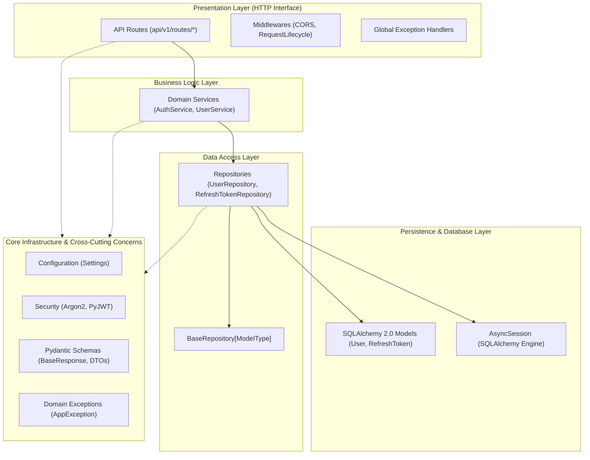
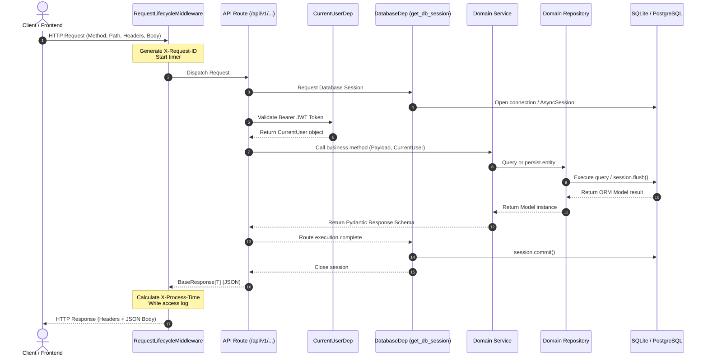
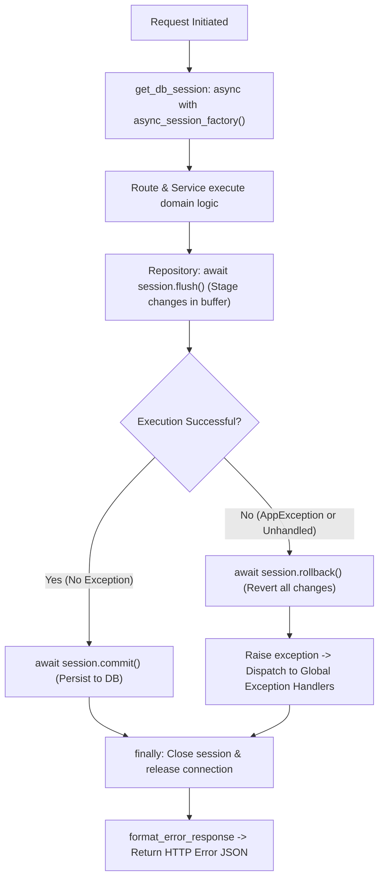
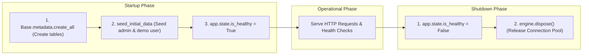

# HUCE-KMS — Backend Technical Architecture

> **Project**: HUCE-KMS (Knowledge Management System & AI Assistant - Hanoi University of Civil Engineering)  
> **Document**: Backend Technical Architecture & System Design  
> **Last Updated**: 2026-11-08  
> **Status**: Verified against active codebase (Phase 1 Foundation)

---

## 1. Backend Overview

The HUCE-KMS backend serves as the core engine powering all data processing, API endpoints, security infrastructure, user identity management, and persistent storage for the platform.

The backend is specifically engineered to:
- Serve the Frontend client application (Next.js 16) through standardized RESTful APIs.
- Manage multi-device user sessions using a secure token rotation mechanism.
- Provide an extensible architecture ready for subsequent phases, including document management, academic regulatory knowledge bases, and intelligent AI retrieval.

---

## 2. Technology Stack

All components in the table below have been verified directly from `pyproject.toml`, `uv.lock`, and the source code in `apps/backend/src/api`:

| Category | Technology / Library | Version | Role & Responsibility in System |
| :--- | :--- | :--- | :--- |
| **Language** | Python | `>= 3.12` | Primary backend runtime, utilizing modern syntax and type hints |
| **Package Manager** | `uv` / `uv_build` | `>= 0.13` | Fast package management, virtual environment isolation, and builds |
| **Web Framework** | FastAPI (standard) | `>= 0.162` | HTTP routing, automated OpenAPI/Swagger generation, async request processing |
| **ASGI Server** | Uvicorn | Bundled | High-performance asynchronous ASGI web server |
| **ORM / Data Access** | SQLAlchemy (asyncio) | `>= 2.0` | Modern 2.0 ORM, non-blocking queries using `select()` and `Mapped` |
| **Database Driver** | aiosqlite | `>= 0.20` | Async SQLite driver powering local development (`huce_kms.db`) |
| **Schema & Validation** | Pydantic V2 & Settings | `>= 2.10` | Input/output DTOs, data serialization, and `.env` settings management |
| **Hashing & Auth** | pwdlib (Argon2id) | `>= 0.2.1` | OWASP-compliant password hashing using Argon2id |
| **JWT** | PyJWT | `>= 2.9.0` | Generation and verification of HS256 JSON Web Tokens |
| **Migrations** | Alembic | `>= 1.13` | Database schema version control and migration tooling |

---

## 3. Architecture Style

The HUCE-KMS backend implements a **Layered Architecture** adhering to Separation of Concerns principles inspired by Clean Architecture:

1. **Complete Separation of HTTP and Domain**: The Route Layer only handles HTTP deserialization and response wrapping; the Service Layer contains pure domain business logic; the Repository Layer abstracts database interactions.
2. **Async-First Execution**: All request processing—from Middlewares and Route Controllers to Services, Repositories, and the Database Engine—runs non-blocking I/O using Python's `async/await`.
3. **Inversion of Control via Dependency Injection**: Architectural layers interact through FastAPI's standard Dependency Injection system (`Depends`), enabling clean isolation, testability, and substitution.



---

## 4. Repository Structure

```text
apps/backend/
├── migrations/                           # Alembic Database Migrations
│   ├── env.py                            # Async migration execution context
│   └── script.py.mako                    # Migration generation template
├── src/
│   └── api/
│       ├── core/                         # Infrastructure & Cross-cutting components
│       │   ├── config.py                 # Pydantic Settings (ENV, CORS, JWT keys)
│       │   ├── database.py               # Async Engine, sessionmaker, Base, TimestampMixin
│       │   ├── dependencies.py           # DatabaseDep, CurrentUserDep, PaginationDep, RBAC
│       │   ├── exceptions.py             # AppException hierarchy & global handlers
│       │   ├── lifespan.py               # App startup (create_all, data seeding) & shutdown
│       │   ├── logging.py                # RotatingFileHandler & console logger setup
│       │   ├── middleware.py             # CORSMiddleware, RequestLifecycleMiddleware
│       │   └── security.py               # Argon2id password hashing, JWT creation/decoding
│       ├── models/                       # SQLAlchemy 2.0 ORM Declarative Models
│       │   ├── refresh_token.py          # RefreshToken model (tokens, expiration, revocation)
│       │   ├── user.py                   # User model (accounts, credentials, roles, status)
│       │   └── __init__.py               # Base & model exports
│       ├── repositories/                 # Data Access Object pattern
│       │   ├── base.py                   # Generic BaseRepository[ModelType] (CRUD)
│       │   ├── refresh_token.py          # RefreshTokenRepository (query, revoke, revoke_all)
│       │   ├── user.py                   # UserRepository (by_username, by_email, search)
│       │   └── __init__.py               # Repository exports
│       ├── schemas/                      # Pydantic V2 DTOs
│       │   ├── common.py                 # BaseResponse, PaginationMeta, PaginatedData
│       │   ├── user.py                   # User DTOs (Create, Update, Response, Login, Token)
│       │   └── __init__.py               # Schema exports
│       ├── services/                     # Domain Business Logic
│       │   ├── auth.py                   # AuthService (Register, Login, Rotation, Logout)
│       │   ├── user.py                   # UserService (CRUD, search, role & status updates)
│       │   └── __init__.py               # Service exports
│       ├── v1/                           # API Version 1
│       │   └── routes/
│       │       ├── auth.py               # /api/v1/auth endpoints & cookie management
│       │       ├── router.py             # Root APIRouter mounting all v1 sub-routers
│       │       ├── users.py              # /api/v1/users endpoints & RBAC enforcement
│       │       └── __init__.py
│       ├── main.py                       # Application Entry Point & bootstrap
│       └── __init__.py
├── alembic.ini                           # Alembic configuration file
├── huce_kms.db                           # Local SQLite database file
├── pyproject.toml                        # Project metadata, build system & dependencies
└── uv.lock                               # Exact dependency lockfile
```

---

## 5. Layer Responsibilities & Conventions

### 5.1. Core Layer (`api.core`)
Provides reusable technical infrastructure:
- **`config.py`**: Defines the `Settings` class inheriting from `pydantic-settings.BaseSettings`. Manages environment variables, `DATABASE_URL`, CORS origins, token lifetimes, and cookie security flags.
- **`database.py`**: Initializes `create_async_engine` and `async_sessionmaker`. Defines `Base(AsyncAttrs, DeclarativeBase)` and `TimestampMixin` (providing timezone-aware `created_at` and `updated_at`).
- **`dependencies.py`**: Central repository for FastAPI dependencies:
  - `DatabaseDep`: Provides request-scoped database sessions with automatic commit/rollback.
  - `PaginationDep`: Validates and extracts `skip` and `limit` pagination parameters.
  - `CurrentUserDep`: Decodes access tokens, retrieves the user from the database, and validates active status (`is_active`). Supports dev bypass tokens (`admin-token`, `user-token`) when `DEBUG=True`.
  - `AdminUserDep`: Enforces the `admin` role.
- **`exceptions.py`**: Custom exception hierarchy rooted in `AppException`. Registers 4 global exception handlers standardizing errors into `format_error_response`.
- **`lifespan.py`**: Manages application startup and shutdown. Automatically generates tables (`Base.metadata.create_all`), seeds default admin and demo user accounts, and closes database connections on shutdown (`engine.dispose`).
- **`logging.py`**: Configures unified logging combining Console and `RotatingFileHandler` (10MB per file, 5 backup files in `logs/app.log`).
- **`middleware.py`**: Registers `CORSMiddleware` and `RequestLifecycleMiddleware` (generates `request_id`, tracks execution time `process_time_ms`, and injects response headers `X-Process-Time` and `X-Request-ID`).
- **`security.py`**: Handles Argon2id password hashing via `pwdlib`, JWT signing/decoding, and cryptographically secure random token generation (`secrets.token_urlsafe(48)`).

### 5.2. Models Layer (`api.models`)
- Contains ORM data entities mapped directly to database tables.
- Contains no business logic or complex validation (input validation belongs strictly in Pydantic schemas).
- Defines explicit SQLAlchemy relationships (e.g., `User.refresh_tokens` with cascade `all, delete-orphan`).

### 5.3. Repositories Layer (`api.repositories`)
- Executes SQL queries through the SQLAlchemy 2.0 ORM.
- Inherits from `BaseRepository[ModelType]` for standard CRUD operations.
- Methods accept primitive arguments (IDs, usernames, filters) or Model entity instances.
- **Critical Rule**: Repositories MUST only call `await self.session.flush()` to stage changes into the current transaction. Repositories MUST NEVER call `commit()`.

### 5.4. Services Layer (`api.services`)
- Contains all business rules and domain logic.
- Receives input from route handlers as Pydantic schemas or primitive values.
- Performs bidirectional conversion between Models and DTO schemas (`UserResponse.model_validate(user)`).
- Raises standard domain exceptions (`ConflictException`, `EntityNotFoundException`, etc.).

### 5.5. Routes Layer (`api.v1.routes`)
- Receives incoming HTTP requests and applies security/dependency injection (`CurrentUserDep`, `AdminUserDep`, `PaginationDep`).
- Instantiates Services using factory dependency functions (`get_auth_service`, `get_user_service`).
- Manages session cookies (`Set-Cookie: refresh_token=...`).
- Returns standardized `BaseResponse[T]` payloads with appropriate HTTP status codes.

---

## 6. Dependency Direction

The system strictly enforces a top-down architectural dependency flow:

$$\text{Routes (v1)} \longrightarrow \text{Services} \longrightarrow \text{Repositories} \longrightarrow \text{Models \& Database}$$

Higher layers may call lower layers and shared cross-cutting components (`core`, `schemas`). Upward or inverted dependencies are strictly forbidden.

---

## 7. Request Lifecycle

The sequence diagram below illustrates an HTTP request traversing the full system stack:



---

## 8. Database Interaction & Transaction Flow

HUCE-KMS manages transactions using a **Request-Scoped Unit of Work** pattern:



---

## 9. Dependency Injection Mechanism

FastAPI Dependency Injection is applied consistently across all endpoints using standard Python 3.12 `Annotated` syntax:

```python
# 1. Database Session
DatabaseDep = Annotated[AsyncSession, Depends(get_db_session)]

# 2. Service Injection via Route-level Factory
def get_user_service(db: DatabaseDep) -> UserService:
    user_repo = UserRepository(db)
    refresh_token_repo = RefreshTokenRepository(db)
    return UserService(user_repo, refresh_token_repo)

UserServiceDep = Annotated[UserService, Depends(get_user_service)]

# 3. Route Handler Usage
@router.get("/{user_id}", response_model=BaseResponse[UserResponse])
async def get_user(
    user_id: Annotated[int, Path(ge=1)],
    current_user: CurrentUserDep,
    service: UserServiceDep,
):
    ...
```

---

## 10. Exception Handling Flow

All application errors are normalized into a standardized JSON envelope via `format_error_response`:

```json
{
    "success": false,
    "code": "<ERROR_CODE>",
    "message": "<User-friendly error description>",
    "details": null,
    "data": null
}
```

Centralized exception handlers registered in `api.core.exceptions.register_exception_handlers`:
1. `AppException`: Catches all explicit domain errors (`EntityNotFoundException`, `BadRequestException`, `UnauthorizedException`, `ForbiddenException`, `ConflictException`).
2. `StarletteHTTPException`: Normalizes default framework HTTP errors (404 Not Found, 405 Method Not Allowed).
3. `RequestValidationError`: Normalizes Pydantic validation errors (HTTP 422), formatting errors into a structured `details: [{"field": ..., "message": ..., "type": ...}]` array.
4. `Exception`: Catches unexpected 500 server errors, logs full stack traces to `logs/app.log`, and prevents leakage of internal infrastructure details to clients.

---

## 11. Authentication & Session Architecture

HUCE-KMS implements a secure **Dual-Token Authentication** mechanism:

1. **Access Token (Short-lived)**:
   - Bearer JWT (signed with HS256).
   - Lifetime: 30 minutes (`ACCESS_TOKEN_EXPIRE_MINUTES`).
   - Claims: `sub` (username), `id` (user_id), `role` (user role), `type`: `"access"`.
   - Returned in JSON payload for client in-memory storage or `Authorization` headers.
2. **Refresh Token (Long-lived & Multi-device Security)**:
   - High-entropy cryptographic random string (`secrets.token_urlsafe(48)`).
   - Lifetime: 7 days (`REFRESH_TOKEN_EXPIRE_DAYS`).
   - Persisted in the `refresh_tokens` database table with `user_id`, `user_agent`, `ip_address`, `expires_at`, and `is_revoked`.
   - Delivered in HTTP responses as a secure **HTTP-only Cookie**:
     `Set-Cookie: refresh_token=...; HttpOnly; SameSite=lax; Path=/` (mitigating XSS theft).
3. **Token Rotation & Reuse Detection**:
   - When calling `/api/v1/auth/refresh`: the old token is revoked (`is_revoked = True`), and a new pair is issued.
   - If an already-revoked refresh token is presented: security reuse detection triggers immediately, **revoking all active sessions for that user** (`revoke_all_for_user`) to neutralize compromised credentials.

---

## 12. Lifecycle & Configuration Management

### 12.1. Configuration (`api.core.config.Settings`)
- Settings load from environment variables or a local `.env` file.
- Automatic validator normalizes string values to boolean for `DEBUG`.
- Default database URL uses an absolute filesystem path pointing to `apps/backend/huce_kms.db`.

### 12.2. Application Lifespan (`api.core.lifespan.lifespan`)


---

## 13. Existing Limitations

1. **SQLite Concurrency**: SQLite is appropriate for local single-developer workflows. Under concurrent write workloads, SQLite may encounter table lock contention.
2. **Alembic Migrations Operationalization**: Alembic is configured in `alembic.ini` and `migrations/env.py`, but `migrations/versions/` currently contains no migration files. Schema creation currently relies on `Base.metadata.create_all` at startup.
3. **Mock Tokens in DEBUG Mode**: Test bypass tokens (`MOCK_USERS_BY_TOKEN`) reside directly in `api/core/dependencies.py`. In production environments, `DEBUG` MUST be set to `False` to prevent unauthorized authentication bypass.
4. **Default CORS Origins**: Permitted CORS origins currently default to local development ports (`localhost:3000`, `localhost:5173`, etc.).

---

## 14. Future Considerations

1. **PostgreSQL Migration**: Transition from `sqlite+aiosqlite` to `postgresql+asyncpg` in production environments.
2. **Formalizing Alembic Migrations**: Transition from startup `create_all` to automated Alembic migration pipelines in CI/CD.
3. **Redis Caching & Token Blacklist**: Incorporate Redis for distributed session caching, token blacklisting, and API rate limiting.
4. **Vector Database & RAG Pipeline Integration**: Extend the Service Layer to interface with a Vector Database (Qdrant / pgvector) and an LLM Orchestrator to support Hanoi University of Civil Engineering knowledge retrieval.
