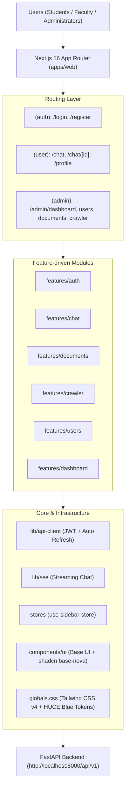

# HUCE KMS — Frontend Technical Architecture

> **Project**: HUCE KMS (Knowledge Management System & AI Assistant - Hanoi University of Civil Engineering)  
> **Document**: Technical Architecture & System Design  
> **Target**: Entire `apps/web` application  
> **Last Updated**: 2026-11-08  
> **Status**: Foundation 100% Completed

---

## 1. System Overview & Design Principles

The HUCE KMS frontend is built with **Next.js 16 (App Router)** and **React 19**, designed to deliver academic knowledge lookup, regulatory document search, and intelligent AI-powered QA communicating with an independent FastAPI backend.

### Core Architectural Principles
1. **Separation of Concerns**: Strict boundary separation between Route Handlers/Pages, Business Feature Modules, Shared UI Primitives, and the API Data Layer.
2. **Feature-driven Co-location**: Modular code encapsulation grouped by domain (`features/<name>/{components, services, types}`).
3. **End-to-End Type Safety**: Strict TypeScript 5.9 mode paired with Zod schemas for all forms and external network payloads.
4. **Resilient AI Streaming**: Server-Sent Events decoder handling multi-byte UTF-8 Vietnamese character boundaries without chunk truncation or display artifacts.

---

## 2. Routing Hierarchy & App Router Design

The application leverages Next.js **Route Groups `(...)`** to isolate layouts, user contexts, and access control:

| Route Group | Path | Layout | Purpose & Domain Scope |
| :--- | :--- | :--- | :--- |
| **Portal** | `/` | Root Layout | Landing page, navigation portal, institutional quick links |
| **Auth** | `/login`, `/register` | `(auth)/layout.tsx` | University account authentication, registration with real-time password checklist |
| **User** | `/chat` | `(user)/layout.tsx` | New conversation initialization, suggested starter prompts |
| **User** | `/chat/[id]` | `(user)/layout.tsx` | Interactive QA session, SSE streaming, reference citations, feedback |
| **User** | `/profile` | `(user)/layout.tsx` | Student profile overview, password management |
| **Admin** | `/admin/dashboard` | `(admin)/admin/layout.tsx` | Administrative dashboard, knowledge metrics, service health |
| **Admin** | `/admin/users` | `(admin)/admin/layout.tsx` | User management table, search, filtering, account activation/lock |
| **Admin** | `/admin/documents` | `(admin)/admin/layout.tsx` | Regulatory document repository, PDF/DOCX vector extraction modal |
| **Admin** | `/admin/documents/[id]` | `(admin)/admin/layout.tsx` | Extracted chunk inspector, metadata editor |
| **Admin** | `/admin/crawler` | `(admin)/admin/layout.tsx` | Crawler source URL registry, ingestion job triggering |
| **Admin** | `/admin/profile` | `(admin)/admin/layout.tsx` | Super Admin account overview & administrator password management |

---

## 3. Data Layer & Backend Communication

### 3.1. Unified API Client (`src/lib/api-client.ts`)
- Encapsulates network operations using native `fetch`.
- **Automatic Bearer Token Injection**: Retrieves access tokens from `localStorage` on client-side requests.
- **Silent Refresh Token Mechanism**:
  - Intercepts `401 Unauthorized` responses and automatically requests a fresh token from `/api/v1/auth/refresh` using the `refresh_token`.
  - On refresh success: updates `access_token` and transparently retries the original request.
  - On refresh expiration or failure: clears storage and redirects the user to `/login`.
- **Multi-Format Payload Support**: Auto-detects `FormData` (for PDF/DOCX file uploads without forcing JSON headers) and `URLSearchParams` (login form payloads).
- Standard helper methods: `apiClient.get()`, `apiClient.post()`, `apiClient.put()`, `apiClient.delete()`.

### 3.2. Server-Sent Events (SSE) Client (`src/lib/sse.ts`)
- Integrates `eventsource-parser` (version 4.1.3).
- Consumes `ReadableStream<Uint8Array>` streams from FastAPI `/chat/completions`.
- Protects Unicode multi-byte character boundaries across irregular network chunks to prevent corrupted Vietnamese text rendering.

---

## 4. Design System & UI Tokens

### 4.1. HUCE Visual Identity
- **Primary Brand Colors**: HUCE Blue (`#0F5BA6`), Hover (`#0B477F`), Accent (`#2879C5`), Subtle (`#EAF3FB`).
- **Surfaces & Neutral Palette**: Background (`#F5F8FC`), Surface (`#FFFFFF`), Border (`#E8EEF5`).
- **Typography**: Be Vietnam Pro (Google Fonts with webfont fallbacks) loaded in `src/app/layout.tsx` and mapped to `--font-sans` / `--font-heading` in `globals.css`, ensuring full Vietnamese diacritics support (replacing the default Next.js Geist font).

### 4.2. Base Component Framework
- **Primitive Engine**: `@base-ui/react` combined with `base-nova` style conventions from `shadcn/ui`.
- 18 atomic UI primitives in `src/components/ui/`: Button, Input, Label, Card, Badge, Dialog, Dropdown Menu, Select, Sheet, Table, Tabs, Textarea, Tooltip, Separator, Avatar, Checkbox, Skeleton, Empty.
- Global notification toaster: `sonner` integrated in Root Layout.
